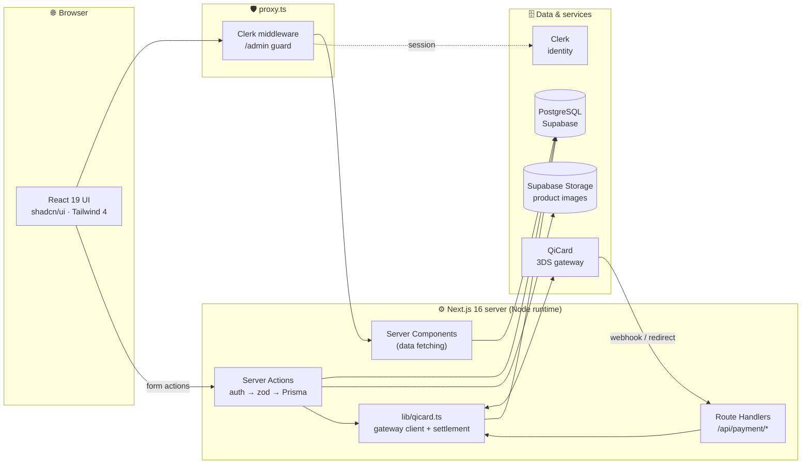
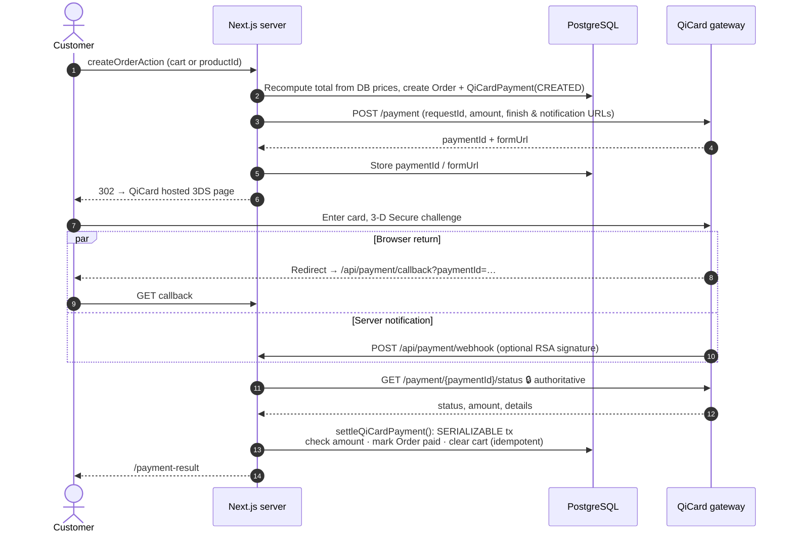

<div align="center">

# 🖥️ PC Store

### A full-stack e-commerce platform for PC hardware, with verified card payments through QiCard

<p>
  
  
  
  
  
</p>
<p>
  
  
  
  
  
</p>

**Server-first architecture · Every mutation validated on the server · Payments confirmed server-to-server**

[Features](#-features) · [Architecture](#-architecture) · [Payment flow](#-payment-flow) · [Data model](#-data-model) · [Security](#-security-model) · [Getting started](#-getting-started)

</div>

---

## 📌 Overview

**PC Store** is a production-oriented online shop built on the **Next.js 16 App Router**. Pages render on the server with React Server Components, every write goes through a typed **Server Action**, and payments go through the **QiCard 3-D Secure gateway**. An order is marked paid only after the server has confirmed the payment with QiCard directly.

It is designed around one rule: **never trust the client.** Prices, quantities, identities, payment results and file names are all recomputed or checked on the server.

---

## ✨ Features

<table>
<tr>
<td width="50%" valign="top">

### 🛍️ Storefront
- Product catalog with **case-insensitive search** and **category filtering**
- Featured products hero carousel (Embla + autoplay)
- Grid / list layouts, loading skeletons for every route
- Product pages with breadcrumbs, ratings and social sharing
- **Favorites** list per user
- **Persistent cart** with server-calculated totals
- **Reviews** tied to the signed-in user (one per product)
- Light / dark theme (`next-themes`)

</td>
<td width="50%" valign="top">

### 🛠️ Admin dashboard
- Route-level guard in `proxy.ts`, plus a **second check inside every admin Server Action**
- Products: create, edit, change image, delete
- Categories: create, edit, change image, delete
- Image uploads to **Supabase Storage**, checked for type and size
- Order overview across all customers

### 💳 Payments
- **QiCard** hosted 3-D Secure checkout
- Single-product **buy now** and full-cart checkout
- Retry payment for unpaid orders
- **Idempotent** settlement inside a serializable transaction
- Webhook audit log (`QiCardWebhookEvent`)

</td>
</tr>
</table>

---

## 🏗️ Architecture



### Request lifecycle of a Server Action

Every mutating action follows the same pipeline:

```text
 ┌──────────────┐   ┌────────────────────┐   ┌──────────────┐   ┌─────────────────┐   ┌──────────────┐
 │  Form submit │ → │ getAuthUser() /    │ → │ Zod schema   │ → │ Prisma query    │ → │ revalidate / │
 │  (FormData)  │   │ getAdminUser()     │   │ validation   │   │ scoped to user  │   │ redirect     │
 └──────────────┘   └────────────────────┘   └──────────────┘   └─────────────────┘   └──────────────┘
```

---

## 💳 Payment flow

Payments are the most sensitive part of the app. The browser and the webhook body only tell the server *which* payment to look at. The *status* and *amount* always come from a server-to-server inquiry to QiCard.



**Guarantees**

| Property | How it is enforced |
|---|---|
| Client cannot set the price | Totals are recomputed from `Product.price` in the DB; quantities must be whole numbers from 1 to 20 |
| Forged callbacks / webhooks are harmless | Status in the query string or body is ignored; only the gateway inquiry counts |
| No payment cross-wiring | Settlement looks up the record **only** by the gateway-issued unique `paymentId` |
| Amount tampering detected | Gateway-confirmed amount must equal the stored amount, otherwise `AMOUNT_MISMATCH` |
| Exactly-once settlement | Serializable transaction plus an early return if the payment is already `SUCCESS` |
| Signed notifications | RSA-SHA256 check against `QICARD_PUBLIC_KEY`; an invalid signature gets `401` |

---

## 🧬 Data model

```mermaid
erDiagram
    Category ||--o{ Product : contains
    Product  ||--o{ Favorite : "is favorited"
    Product  ||--o{ Review : receives
    Product  ||--o{ CartItem : "is in"
    Product  ||--o{ Order : "is ordered"
    Cart     ||--o{ CartItem : holds
    Order    ||--o{ QiCardPayment : "paid by"
    QiCardPayment ||--o{ QiCardWebhookEvent : logs

    Product {
        uuid id PK
        string name
        int price
        bool featured
        string image
        string categoryId FK
        string clerkId
    }
    Cart {
        uuid id PK
        string clerkId
        int numItemsInCart
        int cartTotal
        int orderTotal
    }
    Order {
        uuid id PK
        string clerkId
        int orderTotal
        bool isPaid
    }
    QiCardPayment {
        uuid id PK
        string requestId UK
        string paymentId UK
        string status
        int amount
        string currency
        json details
    }
```



> Users are not stored locally: Clerk is the identity provider, and every user-owned row is keyed by `clerkId`.

---

## 🛡️ Security model

| Layer | Control |
|---|---|
| **Authentication** | Clerk sessions, read on the server with `auth()` / `currentUser()` |
| **Authorization** | `/admin/*` is blocked in `proxy.ts` **and** every admin action calls `getAdminUser()` (defense in depth) |
| **Object-level access** | Cart, favorites and orders are always queried with `clerkId = currentUser`, so users cannot reach each other's data by guessing IDs |
| **Input validation** | Zod schemas for products, categories, reviews and images; cart quantities are range-checked |
| **Identity integrity** | Review author name and avatar come from the Clerk session, never from form fields |
| **File uploads** | Only JPEG/PNG/WebP/GIF up to 1 MB (no SVG); stored under random server-generated names. The image to replace is read from the DB, never from the request |
| **Payments** | Server-to-server status check, amount match, unique-key lookup, serializable idempotent settlement |
| **Secrets** | Read only from environment variables, with no hardcoded fallbacks; `.env*` is git-ignored |
| **Error hygiene** | Database errors are logged on the server and shown to users as a generic message |
| **HTTP headers** | `X-Frame-Options: DENY`, `nosniff`, HSTS, strict `Referrer-Policy`, `Permissions-Policy`; `X-Powered-By` removed |

---

## 🧰 Tech stack

| Concern | Choice |
|---|---|
| Framework | **Next.js 16** (App Router, Server Components, Server Actions, `proxy.ts`) |
| UI | **React 19**, **Tailwind CSS 4**, **shadcn/ui** + Base UI, lucide / react-icons, Sonner toasts |
| Language | **TypeScript 5** (strict) |
| ORM | **Prisma 7** with the `@prisma/adapter-pg` driver adapter |
| Database | **PostgreSQL** on Supabase (pooled + direct URLs) |
| Storage | **Supabase Storage** |
| Auth | **Clerk** |
| Validation | **Zod 4** |
| Payments | **QiCard** REST API (3-D Secure) |

---

## 📂 Project structure

```text
pc-store/
├── app/
│   ├── (auth)/                 # Clerk sign-in / sign-up
│   ├── (dashboard)/admin/      # Admin: products & categories CRUD
│   ├── (root)/
│   │   ├── api/payment/        # Start checkout · callback · webhook
│   │   ├── cart/  favorites/  orders/  products/  reviews/
│   │   └── payment-result/
│   ├── layout.tsx
│   └── page.tsx
├── components/                 # Feature components + shadcn/ui primitives
├── lib/
│   └── qicard.ts               # Gateway client, checkout, settlement, signature check
├── prisma/
│   ├── schema.prisma
│   └── migrations/
├── utils/
│   ├── actions/                # Server Actions grouped by domain
│   ├── schema.ts               # Zod schemas
│   ├── db.ts                   # Prisma singleton
│   └── supabase.ts             # Storage helpers
├── proxy.ts                    # Clerk middleware + admin guard
└── next.config.ts              # Image hosts + security headers
```

---

## 🚀 Getting started

### Prerequisites

- **Node.js 20+**
- A **Supabase** project (Postgres + a public storage bucket named `default-bucket`)
- A **Clerk** application
- **QiCard** sandbox credentials

### 1. Install

```bash
git clone <your-repo-url> pc-store
cd pc-store
npm install          # also runs `prisma generate`
```

### 2. Configure the environment

```bash
cp .env.example .env
```

| Variable | Description |
|---|---|
| `DATABASE_URL` | Pooled Postgres connection string (port 6543) |
| `DIRECT_URL` | Direct Postgres connection string for migrations (port 5432) |
| `CLERK_SECRET_KEY` / `NEXT_PUBLIC_CLERK_PUBLISHABLE_KEY` | Clerk keys |
| `ADMIN_USER_ID` | Clerk user ID that gets admin access |
| `SUPABASE_URL` / `SUPABASE_KEY` | Supabase project URL and **server-only** key |
| `WEBSITE_URL` | Public HTTPS base URL that QiCard redirects and notifies |
| `NEXT_PUBLIC_WEBSITE_URL` | Base URL used for share links |
| `QICARD_BASE_URL` / `QICARD_USERNAME` / `QICARD_PASSWORD` / `QICARD_TERMINAL_ID` | Gateway credentials (required, no defaults) |
| `QICARD_PUBLIC_KEY` | PEM key for webhook signature verification (**required in production**) |

### 3. Database

```bash
npx prisma migrate deploy   # apply migrations
npx prisma studio           # optional: browse data
```

### 4. Run

```bash
npm run dev      # http://localhost:3000
npm run build    # production build
npm start
```

> 💡 To test QiCard callbacks locally, expose port 3000 through an HTTPS tunnel (for example `ngrok` or `cloudflared`) and set `WEBSITE_URL` to the tunnel URL.

---

## 📜 Scripts

| Script | Purpose |
|---|---|
| `npm run dev` | Start the dev server |
| `npm run build` | `prisma generate` + production build |
| `npm start` | Serve the production build |
| `npm run prisma:generate` | Regenerate the Prisma client |

---

## ☁️ Deployment checklist

- [ ] All secrets set in the hosting provider's environment settings, never committed
- [ ] `WEBSITE_URL` set to the production **HTTPS** domain
- [ ] `QICARD_PUBLIC_KEY` configured and production QiCard credentials in place
- [ ] Supabase Storage policies allow writes **only** with the server key
- [ ] `npx prisma migrate deploy` run against the production database
- [ ] `ADMIN_USER_ID` points to the production Clerk user

---

<div align="center">

Built with Next.js, Prisma, Clerk, Supabase and QiCard.

</div>
